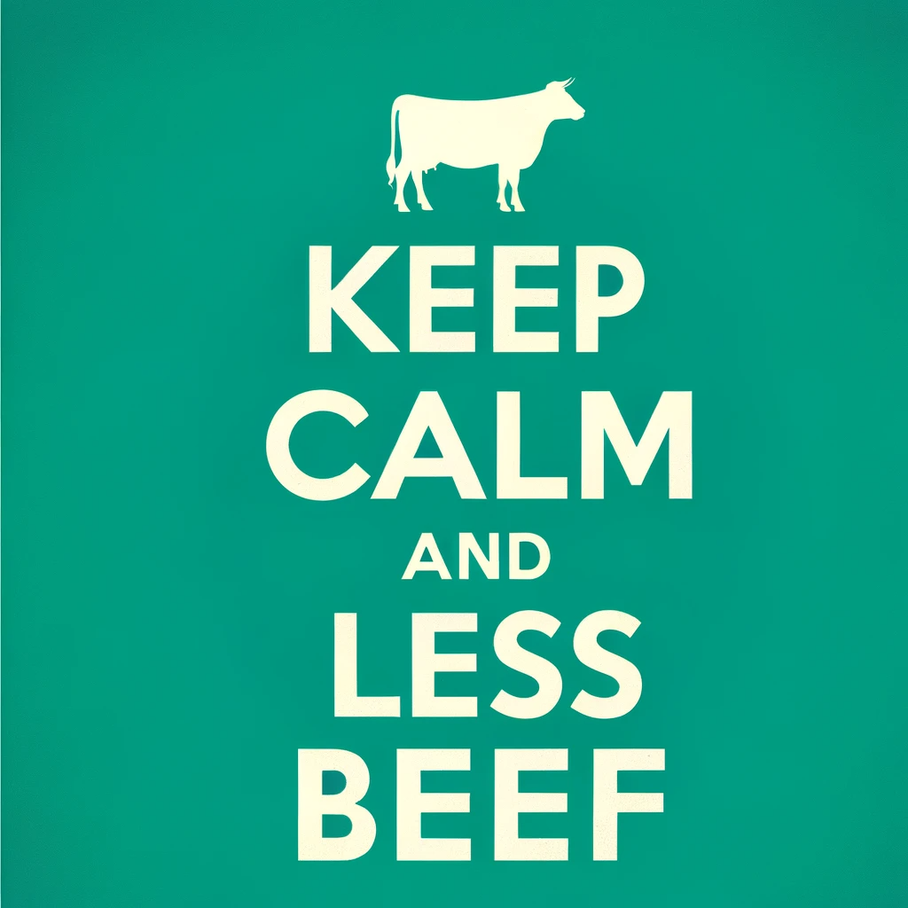

## Introduction

[Not The End of the World](https://amzn.to/47XEbae) is a thought-provoking book written by [Hannah Ritchie](https://hannahritchie.com/) that offers a much-needed voice of data-driven optimism in the field of environmentalism. In this blog post, we will discuss the key points that stood out to me, as well as some areas where the book could have been improved. Overall, Ritchie's book presents a compelling argument for adopting a more sustainable lifestyle, particularly in relation to our consumption of meat.

## Points I Liked

There were several points in many chapters. I want to highlight those that were the most salient to me below.

### A New Hope

One of the aspects I appreciated about [Not The End of the World](https://amzn.to/47XEbae) is Ritchie's emphasis on data-driven optimism. In a time of increasing environmental concerns and ever present doom vibes in the media, it is refreshing to have a book that provides evidence-based reasons for hope. Ritchie presents various datasets and scientific studies that demonstrate how humanity can make progress in addressing environmental challenges. It makes a very compelling case: things are not doomed, we just have to show up and roll up our sleeves. Every 0.1 degree matters. This optimistic perspective is a valuable contribution, as it encourages readers to take action and engage in positive change rather than going into a downward spiral.

### Keep Calm and Less Beef

Another point that resonated with me was Ritchie's rational argument about the need to eat less beef and lamb. She delves into the environmental impact of meat production, highlighting the significant role it plays in greenhouse gas emissions, deforestation, and pollution. I had thought about these issues before but reading this book drove me to write about it in more detail.

{fig-align="center"}

### Radical transparency

Ritchie skillfully avoided the guru trap. Her writing style and candid explanation about what's known and what's up for debate are far from a self portrait of somebody who has all the solutions. The plastic pollution chapter, where she welcomes her future self changing ideas and acknowledges uncertainty, is a prime example of this behavior. I welcome this. I think authors in the non-fiction genre can use more awareness of their limitations without losing credibility. Dear author, when in doubt, Ritchie hits the right spot.

### Clean Air

Finally, I think the air pollution chapter was remarkable. The numbers are clear, the case is compelling, and the progress we have made demonstrates that we can get better air. There's a clear path and we know what to do to dramatically reduce air pollution.

## Areas for Improvement

While [Not The End of the World](https://amzn.to/47XEbae) offers valuable insights, there are a few areas where it could have been enhanced.

### Not my Kindle Charts

Firstly, as a Kindle reader, I found the rendering of the book to be subpar on my Kindle Paperwhite from 2014. With a book that contains numerous plots, it was disappointing to find that the visual elements did not translate well to the e-reader format. Surprisingly, it wasn't the plots being black and white that got me, it was the size of fonts that made it hard to read the text in the plots. Improving the compatibility and readability of the Kindle version would greatly enhance the overall reading experience [^1]. I recommend you get a paper version or read this on a tablet where you can zoom all the way in.

[^1]: This point is not specific to Ritchie’s book, I have found other data-heavy books that fail at this too. It seems that publishers haven’t figured out how to make charts look great on e-readers. Maybe mine is a critique that is more relevant to the people editing this book than to the author herself.

### Pacifying the Crowd

Additionally, it felt at times that the book was primarily written for diehard environmentalists. Ritchie explains she's writing for a previous version of herself (i.e., hardcore environmentalist trapped in negative outlooks for the future). Moreover, she makes a nice case about people in the movement fighting over minutia instead of pulling together towards the common goal. She spends substantial portions of the book acknowledging and talking directly to these readers.

Although I appreciate fighting against greenwashing (I'm talking to you organic cotton tote bag), I believe this is a distraction. I believe her work could have a greater impact by reaching the people who just don't think about these issues at all (i.e., people who buy SUVs and drive them to the burger joint might reconsider some of their choices). I think the true challenge is reaching out to those folks and I was hoping she could have built a bridge for us to use.

### Honorable not mentions

One issue that surprised me was the little mention about the health risks associated with meat (over)consumption. It might be because the case is not settled, but I thought that the health argument would bolster her pragmatic approach to recommend eating less meat.

It also surprised me that she is not concerned about scarcity of materials and is somewhat timid regarding circular economies. Yes, she is likely correct to point out that we have a large amount of space and matter to play with, but the Earth is fundamentally finite. Because the number of atoms we have is somewhat fixed, I would prefer to advocate for changing the production matrix towards a circular economy than keep throwing stuff into landfills.

### Data Nerds Want More

Finally, I would have appreciated more technical details. I understand that the intended audience probably felt bombarded with the already data heavy text, but I would have appreciated more detailed run through of calculations. [Not The End of the World](https://amzn.to/47XEbae) tends to keep things minimal, relying on the trust readers may have in the author's expertise. Although I do trust Ritchie's knowledge and integrity, I wished she had delved deeper into the data and technical aspects behind some of her conclusions. Providing more in-depth analysis and supporting evidence would have strengthened the book's arguments and made it even more compelling.

## Conclusion

In conclusion, [Not The End of the World](https://amzn.to/47XEbae) by Hannah Ritchie is a thought-provoking book that challenges the prevailing narratives of doom and gloom surrounding environmental issues. Ritchie's emphasis on data-driven optimism serves as a beacon of hope in a time of uncertainty. While the book could benefit from improvements in terms of rendering for e-readers and catering to a broader audience, its compelling arguments for reducing meat consumption and adopting a more sustainable lifestyle make it a worthwhile read. [Not The End of the World](https://amzn.to/47XEbae) presents a valuable contribution to the ongoing conversation about our planet's future and the role we can play in creating positive change.
